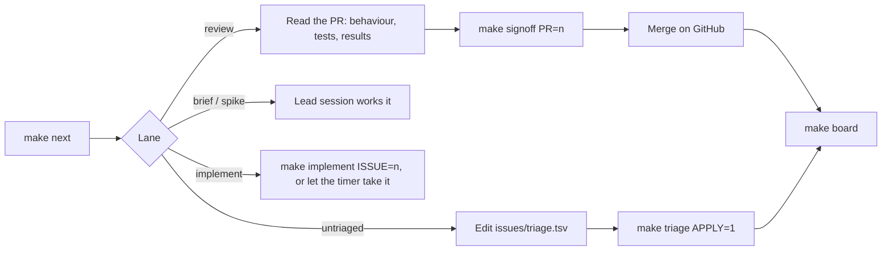

# Runbook

Every task is a `make` target; `make help` lists them. This page says **when** to run which, and in which order. For a job from start to end, with what you should see and what to do when it fails, see the [guides](docs/README.md). Run everything from this repository's root on the workstation. Nothing here asks for a token: `gh` uses your own login.

## I want to…

| I want to… | Run | Changes anything? |
| :-- | :-- | :-- |
| See what is next | `make next` | No |
| See the whole backlog in order | `make backlog` | No |
| Find issues missing a label | `make backlog-check` | No |
| Set labels and blocked-by links from `issues/triage.tsv` | `make triage`, then `make triage APPLY=1` | Labels and links on GitHub |
| Refresh the Roadmap board | `make board` | The board only |
| Certify a pull request I reviewed | `make signoff PR=<n>` (another repository: `make signoff PR=<n> REPO=architecture`), then merge on GitHub | Rewrites the PR branch with your sign-off; refuses a clone that is not that repository's |
| Code with Claude locally, unbilled | `make claude-gpu` (fast) or `make claude-cpu` (128k window, slow) | No |
| Run the implementer on one issue | `make implement ISSUE=<n>` (`HARNESS=claude` for Claude Code) | Branch, draft PR, labels |
| Draft the next brief, have Claude check it, and publish it if it is clean | `make draft-next-brief` (`ISSUE=<n>`, `DRY=1`) | A comment on the issue and its status label, only when the check finds nothing wrong |
| Have a local model draft a brief or an ADR (written to a file, never posted) | `make draft-brief ISSUE=<n>`, `make draft-adr TITLE=... DECISION=...` | `~/.cache/linux-hello-drafts/` |
| Update the agents' shared memory, or ask it something | `make memory-index`, `make memory-query Q='...'` (`TIER=private` to include your notes) | The memory database only |
| See or free the GPU | `make models`, `make models-unload` | Unloads models |
| Run one unattended tick by hand | `make implement-next` | As above, for the next ready issue |
| Throw away local changes in the clone | `make reset` | Clone only; rescues uncommitted work first |
| Check this tooling | `make test` | No |

`make next`, `make backlog` and `make board` read the order from `scripts/backlog/backlog.sh` in your clone of `linux-hello` (`CLONE_DIR`, default `~/projects/LinuxHello/linux-hello`), so they agree with `make next` in that repository and with the unattended loop. Pull `main` there first.

## The daily loop (maintainer)



1. `make next`. The *review* lane is yours: read the pull request, `make signoff PR=<n>`, merge.
2. The *brief* and *spike* lanes are the lead's (a Claude session). The *implement* lane is the implementer's: the timer, or `make implement ISSUE=<n>`.
3. After merging or triaging, `make board` so the board matches.

## Backlog rules (short)

Full version: `docs/project/backlog.md` in the monorepo.

- Every open issue: exactly one `status:` and one `priority:` (`now`, `next`, `later`).
- Dependencies are GitHub *blocked by* links, not prose.
- **Next** = highest priority, no open blocker, lowest issue number.

## Roadmap board

### Create it (once)

```sh
gh auth refresh -s project   # adds the project scope to your own gh login; interactive
make labels                  # priority:* and status:blocked
make triage                  # read the plan
make triage APPLY=1
make board                   # creates the public board, then fills it
```

`make board` prints the board's URL. Put it in the monorepo's `docs/project/backlog.md` in place of the organisation's projects link.

### Board views (once, by hand: GitHub has no API for views)

On the board, rename the default view and add two more:

| View | Layout | Group by | Sort | Filter |
| :-- | :-- | :-- | :-- | :-- |
| **Next up** | Board | Lane | Order ↑ | `no:"Waiting for"` |
| **Backlog** | Table | Lane | Order ↑ | (none) |
| **By milestone** | Table | Milestone | Order ↑ | (none) |

In the board's *Workflows*, turn on **Auto-add to project** for `LinuxHello/linux-hello`, filter `is:issue is:open`.

### Keeping it current

The board mirrors labels; it is never edited directly. Run `make board` after triage or merges. **Untested** against the GitHub API.

## Unattended implementer (ADR-0007)

Status: **untested against a live model and a live user manager.** `make test` tests the loop's logic with fake `gh`, model server, backlog and implementer.

One tick of `local/lh-implement-next.sh`:

1. takes a lock, so ticks never overlap;
2. skips if the model server has another model loaded (except the ones named in `LH_EVICT_MODELS`, which the run unloads) or `LH_BUSY_CHECK` reports the GPU busy;
3. picks the first `status:ready` issue in backlog order (`backlog.sh order ready`) that has an `## Implementation brief`;
4. cleans the clone with `lh-reset.sh -y --main`;
5. runs `lh-implement.sh` with `LH_UNATTENDED=1` (no sign-off, no signing requirement) under `LH_RUN_TIMEOUT`;
6. on failure, returns the issue to `status:ready`; after `LH_MAX_ATTEMPTS` failures, sets `status:blocked` and comments the last 40 log lines, with paths, user, host, models and endpoint replaced by placeholders.

`lh-implement.sh` takes the harness from `LH_HARNESS` (`aider` or `claude`). The model's process runs without a GitHub token, gh login or git credential helper.

### Set up (maintainer, once)

1. Create a dedicated user without sudo, and let its user manager run without a login:

   ```sh
   sudo useradd --create-home --shell /bin/bash lh-implementer
   sudo loginctl enable-linger lh-implementer
   ```

2. As that user: clone this repository and `LinuxHello/linux-hello`, set a git identity, and log `gh` in with a fine-grained token limited to `LinuxHello/linux-hello`: contents, pull requests and issues read and write, nothing else. You create the token; no agent sees it.
3. Install Aider (`local/install-aider.sh`) and/or Claude Code, cargo, `cargo-deny`, jq and curl for that user.
4. As that user, run `make implementer-env` in this checkout. It creates `~/.config/linux-hello/implementer.env` (mode 600) from `local/implementer.env.example` with this checkout, the clone and the default model filled in, and never overwrites an existing file; `make all` runs it too. Check the values, in particular `OLLAMA_MODEL`.
5. Install and start the timer:

   ```sh
   mkdir -p ~/.config/systemd/user
   cp local/systemd/lh-implementer.{service,timer} ~/.config/systemd/user/
   systemctl --user daemon-reload
   systemctl --user enable --now lh-implementer.timer
   ```

6. Watch it: `journalctl --user -u lh-implementer.service -f`. Logs of each run are under `~/.local/state/linux-hello-implementer/logs/`.

### Trial briefs (before relying on the loop)

Run each trial brief once per harness, from the same `main` commit, each on its own branch so the two runs do not mix. `make reset` between the runs:

```sh
LH_BRANCH=issue-<n>-aider  make implement ISSUE=<n> HARNESS=aider
make reset
LH_BRANCH=issue-<n>-claude make implement ISSUE=<n> HARNESS=claude
```

Each run opens its own draft pull request. Record the results in the trials tracking issue (#55). A run succeeds only if the gates pass **and** the lead's conformance review finds the brief implemented; the gates alone did not catch Policy 1/4 implementing a different schema. Set the winning harness as `LH_HARNESS` in `implementer.env`.

## Organisation setup (done)

These created the organisation and the monorepo in November 2026. They are idempotent and safe to re-run; you should not need them again.

| Target | Changes |
| :-- | :-- |
| `preflight` | Nothing: read-only checks, fails closed |
| `org` | Org description, base permission read, members cannot create or fork repos, web commit sign-off, Actions allow-list, read-only workflow token |
| `repo` | Creates `LinuxHello/linux-hello` (public), squash-only, secret scanning and push protection, Dependabot, private vulnerability reporting |
| `seed` | First signed-off commit of the template and sanitised architecture docs; skips if `main` exists |
| `protect` | Ruleset on `main`, labels, milestone M0 |
| `labels` | Every label, including `priority:*` and `status:blocked` |
| `security`, `sonar` | Code scanning and SonarQube Cloud |
| `verify` | Nothing: prints the effective state |

Prerequisites if you ever do: `gh auth refresh -s admin:org,repo,workflow`; 2FA required for the organisation (web UI); the architecture files in `ARCH_SRC`.
