# Dependency map of the open issues

Generated by `make map` from `issues/triage.tsv` and the open issues. An arrow means the issue it points to waits for the one it leaves. Do not edit by hand.

```mermaid
flowchart TD
  n131["#131 SetUserPolicy needs no user verification an..."]
  n136["#136 ADR and spike: how a session is unlocked an..."]
  n172["#172 Agent: load the policy and answer from it;..."]
  n175["#175 The presence prompt process is confined and..."]
  n177["#177 Spike: what authenticates the presence prom..."]
  n180["#180 Save the PIN lockout records to a file and..."]
  n181["#181 Map the policy's lockout settings to the PI..."]
  n182["#182 Count a failed PIN in the PIN path and refu..."]
  n183["#183 Test P-14 against a software TPM and that L..."]
  n184["#184 VM check: N wrong PINs for user A leave use..."]
  n186["#186 The Agent's PIN socket: a dedicated unix so..."]
  n187["#187 Stretch the PIN with a per-user salt before..."]
  n188["#188 TPM sessions: salted HMAC sessions with par..."]
  n193["#193 Define what a client does when the Agent's..."]
  n194["#194 VM checks for Agent availability at login"]
  n195["#195 Agent-side method orchestrator: run face, f..."]
  n196["#196 pam_linuxhello as a thin synchronous client..."]
  n197["#197 Shipped PAM snippets keep pam_unix after pa..."]
  n198["#198 VM runs of the PAM module in login, unlock,..."]
  n201["#201 Use open_named and drop a leaving peer's pr..."]
  n205["#205 Bus test that kills the opener of a prompt"]
  subgraph g1["agent"]
    n131
    n136
  end
  subgraph g2["agent"]
    n172
    n180
    n181
    n182
    n183
    n184
    n186
    n187
    n188
  end
  subgraph g3["security"]
    n175
    n177
  end
  subgraph g4["dbus"]
    n193
    n194
  end
  subgraph g5["pam"]
    n195
    n196
    n197
    n198
  end
  subgraph g6["agent"]
    n201
    n205
  end
  n136 --> n131
  n177 --> n175
  n172 --> n181
  n180 --> n182
  n181 --> n182
  n186 --> n182
  n182 --> n183
  n182 --> n184
  n186 --> n187
  n186 --> n188
  n193 --> n194
  n195 --> n196
  n196 --> n198
  n197 --> n198
  n201 --> n205
  classDef yours fill:#EEEDFE,stroke:#534AB7,color:#26215C
  classDef ready fill:#E1F5EE,stroke:#0F6E56,color:#04342C
  classDef waits fill:#F1EFE8,stroke:#5F5E5A,color:#2C2C2A
  classDef active fill:#FAEEDA,stroke:#854F0B,color:#412402
  class n131 waits
  class n136 yours
  class n172 ready
  class n175 waits
  class n177 yours
  class n180 ready
  class n181 waits
  class n182 waits
  class n183 waits
  class n184 waits
  class n186 ready
  class n187 waits
  class n188 waits
  class n193 ready
  class n194 waits
  class n195 ready
  class n196 waits
  class n197 ready
  class n198 waits
  class n201 ready
  class n205 waits
```

Purple: your decision or a spike. Green: can be briefed or implemented now. Grey: waits for another issue. Amber: being worked on or in review.

## Open issues with no dependency

**your decision or a spike**

- #118 Spike: virtual CTAP authenticator on real sites and in the browsers p...
- #120 Spike: resident keys, user presence and user verification in the virt...
- #138 Virtual CTAP authenticator: bind the device to one user and one activ...
- #142 Spike: revoke the old root-key blob on a PIN change
- #153 Spike: face-match latency and cancellation with Howdy as a subprocess
- #154 Measure and bound TPM cost per passkey operation on a hardware TPM
- #156 Agent API: errors and state carry too little for a usable interface

**can be briefed or implemented now**

- #134 Harden the Agent unit and profile before it handles secrets
- #141 Howdy as a factor: privileged helper, sandboxing and what policy can...
- #143 Per-user state outlives the user: uid reuse inherits policy and key b...
- #145 Agent availability at login: activation, ordering, restart and health
- #146 User policy store: error paths report the wrong outcome
- #148 Documentation and model drift after ADR-0005, ADR-0014 and ADR-0018
- #149 Run the confinement and bus-policy checks in CI, not by hand
- #150 Agent request path: one lock, a bus round trip and blocking disk I/O...
- #151 Policy engine: cache the effective policy instead of reading files pe...
- #152 Define latency and availability budgets and test them
- #155 One place to see why Linux Hello is not working: status, doctor and m...
- #157 Tell the user before and after device-bound passkeys are lost
- #162 Decide what identifies the PAM module among processes of the same use...
- #171 Audit: record the caller's bus name (LH_PEER) with every event
- #173 Presence needs a sensor gesture when policy requires it
- #174 UV is set only after verification for this request or a short window
- #176 One prompt and one signature per ceremony when a browser repeats getA...
- #185 Drop 'TPM dictionary-attack parameters' from the schema documentation...
- #189 Clear PIN buffers, keep secret types out of Debug, disable core dumps
- #190 Update the C4 model and arc42 for the PIN socket (ADR-0021)
- #191 Agent watchdog: WatchdogSec, pings from the bus loop and the AppArmor...
- #192 Agent health call and 'linuxhello-ctl status'; SIGTERM handling and e...
- #199 Update the C4 model and arc42 for the PAM module and orchestrator (AD...
- #202 Prompts expire after a maximum lifetime without a report
- #203 Unsubscribe, and a Closed notification to subscribers
- #204 The same opener may reopen its own prompt id
